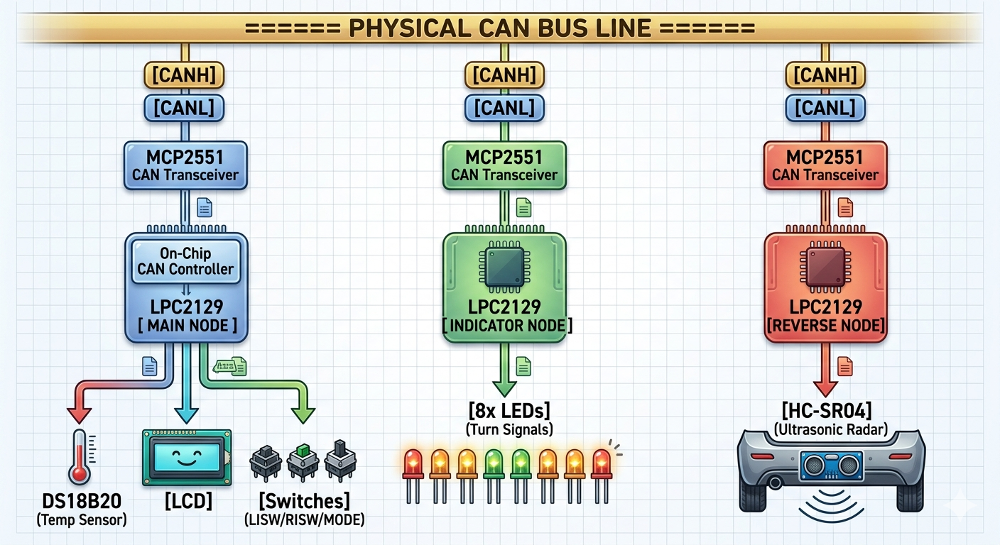
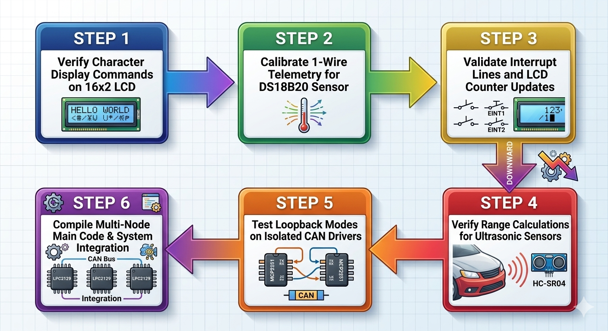
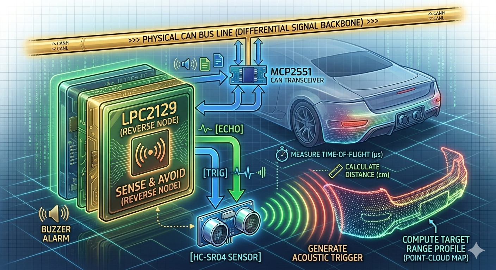
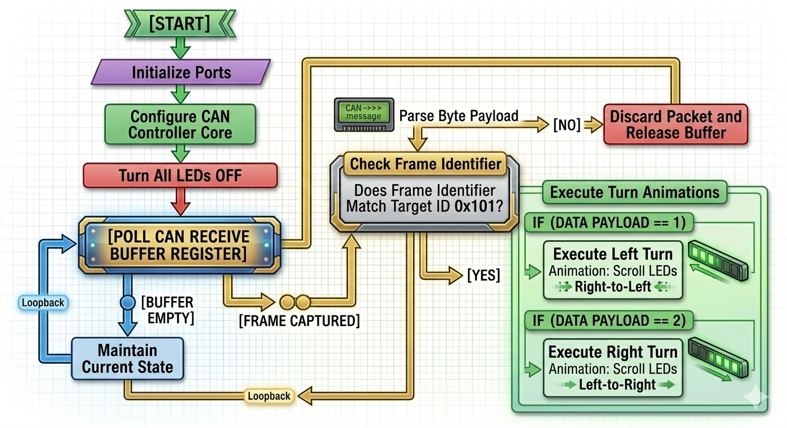
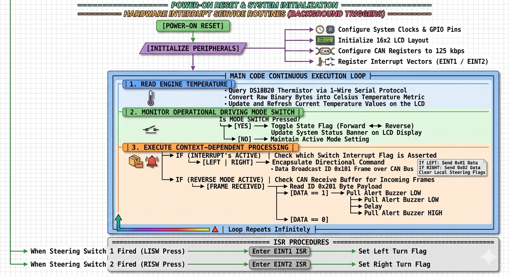

# CAN-Based Vehicle Monitoring and Reverse Safety System


A three-node embedded systems prototype demonstrating vehicle-status monitoring and driver alerts using the Controller Area Network (CAN) protocol. The system combines engine-temperature measurement, interrupt-driven indicator requests, forward/reverse mode selection, and ultrasonic reverse-obstacle detection.

> **Project scope:** This is an educational prototype, not production automotive safety equipment. It has not been represented as automotive-certified or safety-validated software.

## Contents

- [Project Overview](#project-overview)
- [Features](#features)
- [System Architecture](#system-architecture)
- [Operating Sequence](#operating-sequence)
- [CAN Message Flow](#can-message-flow)
- [Expected Demonstration](#expected-demonstration)
- [Node Responsibilities](#node-responsibilities)
- [Hardware and Software](#hardware-and-software)
- [Pin Connections](#pin-connections)
- [Sensor Operation](#sensor-operation)
- [CAN Communication](#can-communication)
- [Build and Flash](#build-and-flash)
- [Testing Checklist](#testing-checklist)
- [Limitations and Safety Notes](#limitations-and-safety-notes)
- [Future Improvements](#future-improvements)

## Project Overview

The project uses three LPC2129 microcontroller nodes connected to a shared CAN bus:

1. **Main Node:** Reads the DS18B20 temperature sensor, displays information on an LCD, handles three external-interrupt switches, broadcasts indicator/mode commands, and activates a local reverse warning when the received status indicates a nearby obstacle.
2. **Indicator Node:** Receives indicator commands and runs an eight-LED left/right sequence.
3. **Reverse Alert Node:** Measures obstacle distance with an HC-SR05-compatible ultrasonic module. In reverse mode, it sends the measured distance and a threshold-based alert status over CAN.

## Features

- Engine-temperature monitoring using a DS18B20 digital sensor
- CAN communication between independent embedded nodes
- Interrupt-driven left indicator, right indicator, and mode-switch inputs
- Forward/reverse mode toggling
- Ultrasonic obstacle detection during reverse mode
- LCD status display and buzzer/LED warning output
- Eight-LED indicator animation
- Modular Embedded C drivers for CAN, LCD, DS18B20, ultrasonic sensing, interrupts, and buzzer control

## System Architecture

### Project block diagram

The block diagram gives the high-level view of the three-node system and the shared CAN bus.


### Hardware interface and physical CAN bus

The physical bus uses a differential pair: CANH and CANL. Each LPC2129's on-chip CAN controller communicates through a CAN transceiver such as the MCP2551. The two ends of the bus should be terminated; intermediate nodes should not each receive their own 120 Ω termination.



### Firmware workflow and integration plan

The following workflow illustration summarizes a staged development approach: verify the LCD, bring up DS18B20 1-Wire communication, validate interrupt/LCD behavior, test ultrasonic range calculation, test CAN loopback/communication, then integrate the three node images. Treat this as a development plan, not proof that every stage has passed.



### Reverse-alert node concept

The Reverse Alert Node measures the ultrasonic Echo pulse, calculates a distance, compares it with the configured threshold, and reports distance/alert status to the Main Node over CAN.



### Indicator-node concept

The Indicator Node receives the command frame and maps the command payload to the eight-LED animation.



### Main-node software flow

The Main Node initializes peripherals, continuously updates local monitoring tasks, processes pending switch events, transmits commands, and checks received CAN status.



> **Diagram accuracy note:** These illustrations are explanatory visuals. Where an illustration's labels differ from the source code or hardware (for example, HC-SR04 versus an HC-SR05-compatible module, or the controller model text), use the actual board markings, datasheets, pin configuration, and compiled firmware as the authority. The diagrams do not independently verify wiring or successful tests.

```text
             Left / Right / Mode switches
                         |
                         v
     DS18B20 ---> [ MAIN NODE: LPC2129 ] ---> LCD
                         |                 ---> Buzzer / alert LED
                         |
                    CANH / CANL
                  (shared CAN bus)
                    /         \
                   v           v
      [ INDICATOR NODE ]   [ REVERSE ALERT NODE ]
         LPC2129                 LPC2129
            |                       |
        8 indicator LEDs      HC-SR05 ultrasonic
                                    |
                         distance + alert status
                                    |
                              CAN to Main Node
```

Each node uses its LPC2129 CAN controller and a CAN transceiver such as the MCP2551 to connect the logic-level CAN interface to the differential CANH/CANL bus. The bus requires appropriate termination at its two physical ends; do not add a separate termination resistor at every node.

## Node Responsibilities

### Node 1 — Main Node

**Purpose:** Central monitoring and command node.

**Operation:**

1. Initializes the LCD, DS18B20 interface, CAN controller, buzzer output, and external interrupts.
2. Reads the DS18B20 temperature using its 1-Wire interface and presents the result on the LCD.
3. Uses three falling-edge external interrupts for the mode, left-indicator, and right-indicator switches.
4. The mode switch toggles the state: `0 = Forward`, `1 = Reverse`. The updated mode is sent in CAN message `0x102`.
5. Left/right indicator events are encoded as `L`, `R`, or `S` and sent using CAN message `0x101`.
6. Receives CAN message `0x201` from the Reverse Alert Node. It reads the distance from `Data1` and the alert flag from `Data2`.
7. In reverse mode, activates the local warning output when the received alert flag indicates an obstacle inside the configured range.

The interrupt service routines should do only the time-critical work needed to record the event and request processing. CAN transmission and display updates are handled by the main program loop.

### Node 2 — Indicator Node

**Purpose:** Drive the left and right indicator LEDs based on CAN commands.

**Operation:**

1. Initializes CAN1 and configures `P0.0`–`P0.7` as LED outputs.
2. Polls the CAN receive status and reads available frames.
3. Processes only standard project message ID `0x101` for indicator commands.
4. Interprets `Data1` as ASCII `L` (left), `R` (right), or `S` (off).
5. For `L`, sequences the eight LEDs from index 0 to 7. For `R`, sequences them from index 7 to 0. For `S`, switches all LEDs off.

The current source comments and logic indicate **active-low LEDs**: writing a low level turns an LED on and writing a high level turns it off. Confirm this against the actual board wiring.

### Node 3 — Reverse Alert Node

**Purpose:** Measure the distance to an obstacle and report reverse-safety status.

**Operation:**

1. Initializes CAN1 and the ultrasonic Trigger/Echo GPIO pins.
2. Listens for CAN message `0x102`, which carries the vehicle mode.
3. Takes distance measurements only when the received mode is reverse (`1`).
4. Averages three distance readings to reduce the effect of an individual unstable reading.
5. Compares the averaged distance with the source-code threshold of **20 cm**. A distance below 20 cm sets `alert = 1`; otherwise `alert = 0`.
6. Transmits message `0x201` with two data bytes: distance in `Data1` and alert state in `Data2`.
7. Waits approximately 100 ms before repeating the loop.

If the Echo signal never arrives, the ultrasonic driver uses a timeout to avoid waiting indefinitely. A timeout should be treated as an invalid measurement during testing; confirm the driver's returned value is handled safely by the application.

## Hardware and Software

### Hardware

| Component | Quantity / use | Purpose |
|---|---|---|
| LPC2129 | 3 | Main, Indicator, and Reverse Alert nodes |
| MCP2551 or compatible CAN transceiver | One per node | Physical interface between CAN controller and CANH/CANL bus |
| DS18B20 | 1 | Digital temperature measurement on the Main Node |
| HC-SR05-compatible ultrasonic module | 1 | Reverse obstacle distance measurement |
| Character LCD | 1 | Displays Main Node status and temperature |
| LEDs | 8 on Indicator Node, plus warning LED(s) if fitted | Indicator animation and warning output |
| Buzzer | 1 | Audible reverse warning on Main Node |
| Switches | 3 | Mode, left indicator, and right indicator inputs |
| USB-to-UART adapter / programmer | As required by board | Programming, serial output, or debugging depending on the board setup |
| CAN wiring and termination resistors | As required | Shared CANH/CANL bus connection |

### Software and tools

- Embedded C
- Keil µVision / ARM compiler toolchain compatible with the project
- Flash Magic, if supported by the board's bootloader/programming setup
- LPC21xx device header and the appropriate LPC2129 startup/linker configuration

## Pin Connections

The following map is derived from the GPIO and peripheral definitions in the supplied source files. It describes the **software-configured pins**, not a verified physical schematic. Confirm each connection against the exact LPC2129 package, board schematic, and peripheral pin-multiplexing table before powering the circuit.

### Main Node — LPC2129

| Function | LPC2129 pin / signal | Direction | Notes |
|---|---|---|---|
| LCD data D0–D7 | `P0.8`–`P0.15` | Output | 8-bit LCD data bus |
| LCD RS | `P0.16` | Output | Selects command (`0`) or character data (`1`) |
| LCD EN | `P0.17` | Output | Enable strobe for LCD writes |
| LCD RW | `P0.18` | Output | Write mode when low; read mode when high. Tie low in hardware if the design never reads the LCD and the driver supports that wiring. |
| DS18B20 DQ | `P0.19` | Bidirectional GPIO | 1-Wire data line; requires a suitable pull-up resistor |
| Buzzer control | `P0.20` | Output | Source initializes the output low and uses low as the active state; confirm driver polarity and transistor/buzzer circuit |
| Mode switch | `P0.1` / `EINT0` | Input / external interrupt | Falling-edge interrupt; toggles forward/reverse mode |
| Left indicator switch | `P0.3` / `EINT1` | Input / external interrupt | Falling-edge interrupt |
| Right indicator switch | `P0.7` / `EINT2` | Input / external interrupt | Falling-edge interrupt |
| CAN1 RX | `P0.25` / `RD1` | Peripheral input | CAN receive signal from the transceiver's RXD output |
| CAN1 TX | `P0.24` / `TD1` | Peripheral output | Expected CAN1 transmit pin; verify PINSEL setup in the actual driver and device datasheet |

### Indicator Node — LPC2129

| Function | LPC2129 pin / signal | Direction | Notes |
|---|---|---|---|
| Indicator LED 0 | `P0.0` | Output | Active-low according to the source logic |
| Indicator LED 1 | `P0.1` | Output | Active-low according to the source logic |
| Indicator LED 2 | `P0.2` | Output | Active-low according to the source logic |
| Indicator LED 3 | `P0.3` | Output | Active-low according to the source logic |
| Indicator LED 4 | `P0.4` | Output | Active-low according to the source logic |
| Indicator LED 5 | `P0.5` | Output | Active-low according to the source logic |
| Indicator LED 6 | `P0.6` | Output | Active-low according to the source logic |
| Indicator LED 7 | `P0.7` | Output | Active-low according to the source logic |
| CAN1 RX | `P0.25` / `RD1` | Peripheral input | Connect through the CAN transceiver |
| CAN1 TX | `P0.24` / `TD1` | Peripheral output | Verify peripheral pin selection in the compiled driver |

### Reverse Alert Node — LPC2129

| Function | LPC2129 pin / signal | Direction | Notes |
|---|---|---|---|
| Ultrasonic Trigger | `P0.20` | Output | Sends the trigger pulse to the sensor |
| Ultrasonic Echo | `P0.19` | Input | Measures the returned Echo pulse width |
| CAN1 RX | `P0.25` / `RD1` | Peripheral input | Receives mode messages and other CAN traffic |
| CAN1 TX | `P0.24` / `TD1` | Peripheral output | Transmits distance/alert messages through the transceiver |

### CAN transceiver and bus wiring

For each node, connect the LPC2129 CAN transmit signal to the transceiver's `TXD` input and the transceiver's `RXD` output to the LPC2129 CAN receive signal. Connect all transceivers' `CANH` lines together and all `CANL` lines together. Connect grounds between nodes and use termination resistors at the two ends of the bus. Follow the transceiver manufacturer's supply and decoupling recommendations.

**Important verification:** The source explicitly configures CAN1 RX through `P0.25`; inspect the CAN driver and the LPC2129 datasheet to confirm that CAN1 TX (`P0.24`) is also correctly selected. Do not assume a comment alone proves the peripheral mux is configured correctly.

## Sensor Operation

### DS18B20 — Engine Temperature

The DS18B20 is a digital temperature sensor that communicates over a single data line using the **1-Wire protocol**. Unlike an analog temperature sensor, it sends a digital temperature value, so the Main Node does not need to convert an analog voltage with the ADC.

**Typical read sequence:**

1. The microcontroller issues a 1-Wire reset pulse.
2. The sensor responds with a presence pulse if it is connected and powered correctly.
3. The controller sends the ROM command for a single sensor and the temperature-conversion command.
4. After conversion time, the controller reads the scratchpad temperature registers.
5. The firmware converts the signed raw temperature value into a human-readable temperature for the LCD.

**Wiring guidance:**

- `VDD` → a supply permitted by the sensor datasheet and board design.
- `GND` → common ground.
- `DQ` → Main Node `P0.19`.
- Add the recommended pull-up resistor (commonly around **4.7 kΩ**) from DQ to the logic supply. Confirm the value and voltage against the sensor, wiring length, and board design.
- Ensure the data-line voltage is safe for the LPC2129 GPIO. Do not pull a 3.3 V MCU input up to 5 V unless the specific pin is documented as 5 V tolerant.

**What it contributes:** It supplies the engine-temperature value for monitoring and display. The current documented CAN message list does not include a temperature broadcast; temperature is handled locally by the Main Node in the supplied application.

### HC-SR05-compatible Ultrasonic Sensor — Reverse Distance

An ultrasonic module estimates distance by emitting a short ultrasonic burst and measuring the time until the reflected signal returns.

**Measurement principle:**

1. The Main/Reverse application puts the Trigger output low briefly, then sends a high pulse (the driver targets approximately 10 µs).
2. The module emits an ultrasonic burst and raises Echo for a duration related to the round-trip travel time.
3. The firmware measures the Echo pulse duration using Timer0.
4. Distance is calculated from the sound travel time. A common approximation is:

   `distance_cm ≈ echo_time_us / 58`

   This approximation assumes typical room-temperature speed of sound and the usual HC-SR04-style timing. Confirm the exact module's datasheet and the driver's timer calibration before relying on the numerical result.

**Configured software pins:** Trigger → `P0.20`; Echo → `P0.19` on the Reverse Alert Node.

**Threshold logic:** The current Reverse Node source averages three readings and sets the alert flag when the averaged distance is **less than 20 cm**. The threshold is a software constant, not a universal safe stopping distance.

**Electrical caution:** Many HC-SR04-style modules drive Echo at approximately 5 V. Check the exact HC-SR05 module's output level and the LPC2129 input tolerance. Use a suitable level shifter or resistor divider if required. Never connect a signal above the MCU pin's absolute maximum rating.

## CAN Communication

The source uses the following CAN identifiers and payload fields:

| CAN ID | Sender → receiver | `Data1` | `Data2` | Purpose |
|---|---|---|---|---|
| `0x101` | Main Node → Indicator Node | ASCII `'L'`, `'R'`, or `'S'` | Not used by application | Left, right, or indicators off |
| `0x102` | Main Node → Reverse Alert Node | `0` = forward, `1` = reverse | Not used by application | Reports current vehicle mode |
| `0x201` | Reverse Alert Node → Main Node | Measured distance in cm | `0` = no alert, `1` = obstacle inside threshold | Reverse distance and alert status |

The CAN driver is configured for **125 kbit/s** in `Common/can_defines.h`. All nodes on the bus must use matching bit timing and a compatible CAN physical layer. `Data1` and `Data2` are byte-sized CAN payload fields in this project; ensure distance values fit in one byte and that the receiver interprets them consistently.

## Operating Sequence

This section describes the intended application-level sequence based on the documented source behavior. Exact timing depends on the implementation and clock/timer configuration.

1. **Power-on initialization**
   - Configure the system clock and GPIO pin functions.
   - Initialize the LCD and local outputs.
   - Configure the CAN controller for the project's configured bit rate (125 kbit/s).
   - Configure the Main Node's external-interrupt inputs.
   - Initialize the sensor interfaces used by that node.

2. **Main Node monitoring loop**
   - Request a DS18B20 temperature conversion and read the sensor result.
   - Convert the raw sensor value to a displayable temperature.
   - Refresh the LCD status without unnecessarily clearing/repainting the entire display.
   - Process any left, right, or mode-switch event recorded by an interrupt.
   - Transmit the appropriate CAN command when an application state changes.
   - Check received reverse-alert frames and update the local warning output when appropriate.

3. **Indicator Node**
   - Receive CAN frames.
   - Ignore frames that do not use indicator command ID `0x101`.
   - Interpret the command byte as `L`, `R`, or `S`.
   - Run the matching LED sequence or turn the LEDs off.

4. **Reverse Alert Node**
   - Receive mode updates using ID `0x102`.
   - When reverse mode is active, obtain ultrasonic distance readings.
   - Average three readings as implemented in the source.
   - Compare the averaged result with the configured 20 cm threshold.
   - Send ID `0x201` containing the distance and alert flag.

5. **Main Node alert response**
   - Accept the reverse-alert frame.
   - Check that the vehicle is in reverse and that the alert field indicates an obstacle inside the threshold.
   - Activate the warning output according to the source's buzzer polarity and driver circuit.

### Interrupt handling rule

Keep interrupt service routines short. An ISR should acknowledge/record the event and set a flag; lengthy LCD updates, delays, ultrasonic measurements, or CAN processing should normally happen outside the ISR. This reduces the chance of blocking other interrupts or disrupting timing-sensitive code. Verify the actual implementation follows this rule before claiming it does.

## CAN Message Flow

The three identifiers form a small application protocol:

| Message ID | Meaning | Typical trigger | Receiver action |
|---|---|---|---|
| `0x101` | Indicator command | Left/right switch event or stop command | Indicator Node updates the LED pattern |
| `0x102` | Forward/reverse state | Mode switch changes state | Reverse Alert Node enables/disables reverse measurements |
| `0x201` | Reverse distance and alert state | Reverse Node completes a measurement cycle | Main Node updates its reverse-warning decision |

**Payload interpretation matters.** In this project, the documented `Data1`/`Data2` fields are byte-sized. `Data1` in frame `0x201` is the distance in centimetres, while `Data2` is the alert flag. A byte can represent only 0–255, so the protocol needs an explicit convention for invalid measurements, timeouts, and stale data if it is extended. Do not interpret a timeout or missing frame as a measured zero-centimetre distance.

CAN identifiers are not physical addresses. They identify message types; nodes decide which message types to process by checking the identifier. All nodes must agree on the bit rate, frame format, identifier meaning, and payload layout.

## Expected Demonstration

Use this as a demonstration checklist, not as a claim that the results have already been measured.

- **Temperature display:** the LCD shows a plausible DS18B20 temperature and updates when the sensor temperature changes.
- **Mode selection:** operating the mode switch changes the forward/reverse state and produces the corresponding `0x102` message.
- **Left indicator:** a left command causes the Indicator Node to sequence LEDs in the configured direction.
- **Right indicator:** a right command causes the sequence to run in the opposite direction.
- **Indicator off:** the stop/off command disables the indicator LEDs.
- **Reverse distance:** the Reverse Alert Node measures distance only while reverse mode is active.
- **Threshold behavior:** compare test objects above and below the configured 20 cm threshold and confirm the reported alert flag.
- **Main-node warning:** the buzzer/warning output changes only when the received mode and alert status require it.
- **Bus integrity:** all nodes communicate at the same configured bit rate, with shared ground and correct end-of-bus termination.

For a report or portfolio, add real photographs of the assembled circuit, serial/debug output if available, and a table of measured results (test distance, displayed distance, alert state, and pass/fail). Keep simulated results clearly labelled as simulation and hardware results clearly labelled as hardware.

## Repository Layout

```text
CAN-Based-Vehicle-Monitoring-System/
├── README.md
├── Common/
│   ├── can.c
│   ├── can.h
│   ├── can_defines.h
│   ├── delay.c
│   ├── delay.h
│   ├── defines.h
│   └── types.h
├── Main_Node/
│   ├── main_node.c
│   ├── interrupt.c
│   ├── buzzer.c
│   ├── buzzer.h
│   ├── lcd.c
│   ├── lcd.h
│   ├── lcd_defines.h
│   ├── ds18b20.c
│   └── ds18b20.h
├── Indicator_Node/
│   └── indicator_node.c
├── Reverse_Alert_Node/
│   ├── reverse_node.c
│   └── ultrasonic.c
├── Hardware/
│   └── BLOCKDIAGRAM.jpeg   # Add the actual diagram
└── Documentation/
    └──                  # Add test logs, screenshots, and wiring notes
```

## Build and Flash

The repository contains Embedded C source files, but the supplied archive does not include a complete Keil project/workspace or a confirmed linker/startup configuration. Build each node as a separate firmware image.

1. Open Keil µVision and create or open a project targeting the exact LPC2129 device.
2. Add the node's application file and the required common drivers. For the Main Node, include the LCD, DS18B20, interrupt, and buzzer modules. For the Reverse Alert Node, include the ultrasonic and CAN drivers. For the Indicator Node, include the CAN driver and delay module.
3. Confirm the device startup file, clock setup, memory layout, compiler version, and CAN peripheral pin multiplexing.
4. Compile and resolve all warnings/errors. Check that each node's source files are not accidentally included in another node's build.
5. Program each LPC2129 board using the board's supported programming method. Use Flash Magic only if the board's bootloader and serial wiring support it.
6. Test each node independently, then connect the CAN bus and test the complete system.

Do not describe the firmware as build-verified until all three images have been compiled successfully with the actual toolchain.

## Testing Checklist

- [ ] LCD initialization and character/string display verified
- [ ] DS18B20 presence detection and temperature reading verified against a known reference
- [ ] Mode switch toggles between forward and reverse
- [ ] Left and right switch interrupts trigger the expected CAN commands
- [ ] Indicator Node receives `0x101` and sequences the LEDs in the correct direction
- [ ] Reverse Node receives `0x102` and measures distance only in reverse mode
- [ ] Test distances on both sides of the 20 cm threshold
- [ ] Main Node receives `0x201` and activates/deactivates the warning correctly
- [ ] CAN communication checked for wiring, termination, common ground, bit rate, and error conditions
- [ ] Invalid/missing ultrasonic Echo handled without a false close-obstacle indication
- [ ] System tested after power cycling and with disconnected-sensor conditions

Add real photographs, LCD output images, measured test results, and a short demonstration video only after capturing them from the working hardware. Do not use placeholder images as proof of completed tests.

## Limitations and Safety Notes

- This is an educational prototype and must not be used as the sole safety system in a real vehicle.
- A single fixed distance threshold does not account for vehicle speed, braking distance, sensor blind zones, or environmental conditions.
- Ultrasonic readings can be unreliable on angled, soft, narrow, or irregular obstacles.
- Add handling for sensor failures, stale CAN data, CAN bus-off/error states, switch bounce, and communication timeouts before making stronger reliability claims.
- Verify all pin mappings, voltage levels, pull-ups, transceiver wiring, and CAN termination against the actual hardware and datasheets.
- The code's use of byte-sized payload fields limits the directly transmitted distance range. Define explicit scaling and validity/error codes if the protocol is extended.

## Future Improvements

- Add CAN timeout and error-state handling, plus a safe response when sensor data becomes stale.
- Add sensor-fault detection and explicit invalid-measurement status.
- Improve switch debounce and indicator state handling.
- Add temperature threshold warnings and, if required, a documented CAN temperature message.
- Create a CAN database/message specification and automated host-side test tool.
- Add system-level testing, timing measurements, and a hardware wiring diagram.
- Explore data logging or IoT monitoring as a separate extension.

## Conclusion

This project demonstrates modular Embedded C development on the LPC2129 and practical integration of CAN communication, digital temperature sensing, external interrupts, LCD output, LED control, and ultrasonic distance measurement. Its three-node structure makes it useful for learning how distributed embedded controllers exchange commands and sensor status over a shared communication bus.
